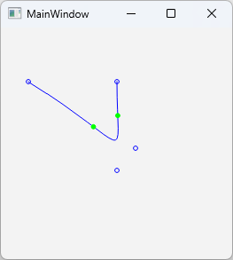
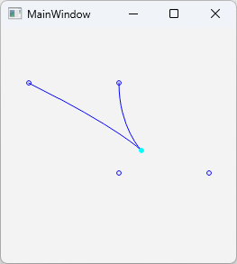
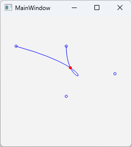

# bzsingular<br>3次ベジェ曲線の特異点の解析的導出<br>Analytic Derivation of Singularities in Cubic Bézier Curves

3次ベジェ曲線の特異点の例：<br>
Examples of singular points on a cubic Bézier curve:
<table>
<tr><td>変曲点<br>Inflection points</td><td>カスプ（尖点）<br>Cusp</td><td>自己交差<br>Self-intersection</td></tr>
<tr><td></td><td></td><td></td></tr>
</table>

以下の記事に掲載した、3次ベジェ曲線の特異点（変曲点、カスプ、自己交差）を検出して描画するサンプルアプリです。<br>
This is a sample application that detects and renders the singularities (inflection points, cusps, and self-intersections) of cubic Bézier curves, as featured in the post below.

[Qiita - 3次ベジェ曲線の特異点の解析的導出](https://qiita.com/kumanomi1000/items/4ba97d0b24ce06f4fb1d)<br>
[Qiita - Analytic Derivation of Singularities in Cubic Bézier Curves](https://qiita.com/kumanomi1000/items/7621db2d05b87884d49d)

- bzsingular.cpp<br>実装例ソースコード<br>Implementation example
- bzsingular.pro main.cpp, mainwindow.h, mainwindow.cpp, mainwindow.ui<br>Qtサンプルアプリ<br>起動するとカスプを含む3次ベジェ曲線と、カスプ点が水色で表示される。<br>制御点をドラッグして移動すると曲線が更新され特異点が再検出される。自己交差があれば赤色、変曲点があれば緑色で表示される。<br>Qt Sample Application<br>When you start the program, a cubic Bézier curve and a cusp point (cyan) will be displayed.<br>Dragging and moving the control points will update the curve and detect singular points. A self-intersection point (red) and inflection points (green) will be displayed when they are existing.
- bzsingular.zip<br>Windows 11上のQt 6.9.1 + MSVC2022 64bitでビルドした実行ファイル。Qtランタイムライブラリが必要。<br>Executable built on Windows 11 using Qt 6.9.1 and MSVC2022 64-bit. Requires Qt runtime libraries.
- paper_j.pdf, paper_e.pdf<br>論文pdf / article pdf

==========

3次ベジェ曲線上の任意の点の座標を；<br>
Let the coordinates of an arbitrary point on a cubic Bézier curve be:
```math
\begin{align}
& x=f(t)=a_0 t^3+a_1 t^2+a_2 t+a_3 \\
& y=g(t)=b_0 t^3+b_1 t^2+b_2 t+b_3
\end{align}
```
とする。ただし $t\in[0,1]$、 $a_i$ と $b_i$ は、3次ベジェ曲線の定義により制御点 $B_0, B_1, B_2, B_3$ について；<br>
where $t\in[0,1]$ and according to the definition of a cubic Bézier curve, the coefficients $a_i$ and $b_i$ are defined in terms of control points $B_0, B_1, B_2, B_3$:
```math
\begin{align}
& a_0=-{B_0}_x+3{B_1}_x-3{B_2}_x+{B_3}_x \\
& a_1=3{B_0}_x-6{B_1}_x+3{B_2}_x \\
& a_2=-3{B_0}_x+3{B_1}_x \\
& a_3={B_0}_x \\
& b_0=-{B_0}_y+3{B_1}_y-3{B_2}_y+{B_3}_y \\
& b_1=3{B_0}_y-6{B_1}_y+3{B_2}_y \\
& b_2=-3{B_0}_y+3{B_1}_y \\
& b_3={B_0}_y
\end{align}
```
とする。また、特異点を求めるための係数を<br>
Also define:
```math
\begin{align}
& v=a_0 b_1-a_1 b_0 \\
& w=a_0 b_2-a_2 b_0 \\
& u=a_1 b_2-a_2 b_1
\end{align}
```
とする。判別式を $D=4uv-3w^2$ とすると、特異点の存在条件およびパラメータ上の位置を以下の統合テーブルにまとめることができる。<br>
Using discriminant $D=4uv-3w^2$, conditions for the existence of singularities and their locations in terms of parameters can be summarized in the following integrated table.
<table>
  <tr>
    <td rowspan="2">$D<0$</td>
    <td rowspan="2">変曲点<br>Inflection points</td>
    <td>$v \ne 0$</td>
    <td>$t=\frac{-w \pm \sqrt{-\frac{D}{3}}}{2v}$</td>
  </tr>
  <tr>
    <td>$v=0 \land w \ne 0$</td>
    <td>$t=-\frac{u}{3w}$</td>
  </tr>
  <tr>
    <td>$D=0 \land v \ne 0$</td>
    <td colspan="2">カスプ<br>Cusp</td>
    <td>$t=-\frac{w}{2v}$</td>
  </tr>
  <tr>
    <td>$D>0 \land v \ne 0$</td>
    <td colspan="2">自己交差<br>Self-intersection</td>
    <td>$t=\frac{-w \pm \sqrt{D}}{2v}$</td>
  </tr>
</table>

